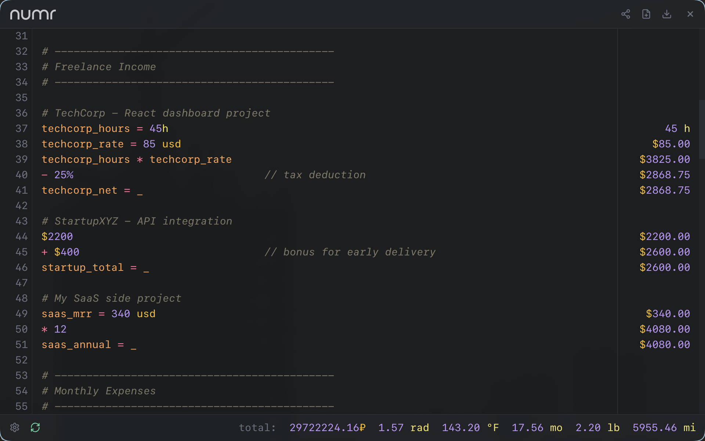
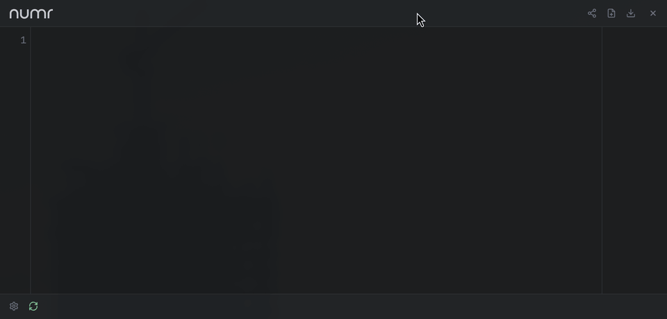

<p align="center">
  
</p>

<p align="center">
  <a href="https://github.com/nasedkinpv/numr-desktop/actions/workflows/ci.yml"></a>
  <a href="https://github.com/nasedkinpv/numr-desktop/releases/latest"></a>
  <a href="https://aur.archlinux.org/packages/numr-desktop-bin"></a>
</p>

Desktop app for [numr](https://github.com/nasedkinpv/numr), the natural-language text calculator. A thin [Tauri 2](https://tauri.app) shell around the [numr-web](https://github.com/nasedkinpv/numr-web) runtime: the same editor and WebAssembly engine as [numr.cc](https://numr.cc), in a native window with a tray icon, file dialogs, and `.numr` file association.

<p align="center">
  
</p>

## Features

- Natural-language calculations with variables, continuations, percentages, units, currencies with live rates, and grouped totals
- Frameless window with a draggable header; closing hides to the tray, a second launch or the tray brings it back
- `.numr` documents: file association, open and save dialogs, drag-and-drop, command-line arguments
- Settings panel for line numbers, line wrapping, and display precision
- Linux: WebKitGTK on native Wayland with HiDPI; macOS: WKWebView menu-bar app without a Dock icon
- Keyboard: Ctrl/Cmd+N new, Ctrl/Cmd+O open, Ctrl/Cmd+S save, Ctrl/Cmd+R refresh rates, Ctrl/Cmd+W hide, Alt+Z wrap lines

<p align="center">
  
</p>

## Installation

Release bundles are on the [latest release](https://github.com/nasedkinpv/numr-desktop/releases/latest) page: `.deb`, `.rpm`, and AppImage for Linux x64 and arm64, `.dmg` for macOS Apple Silicon and Intel.

### Arch Linux (AUR)

```bash
yay -S numr-desktop-bin      # release build
yay -S numr-desktop-git      # built from main
```

### macOS (Homebrew)

```bash
brew tap nasedkinpv/tap
brew install --cask numr-desktop
```

For a fully native macOS and iOS app, see [numr-apple](https://github.com/nasedkinpv/numr-apple).

### Other Linux distributions

Install the `.deb`, `.rpm`, or AppImage from the release page. Runtime dependencies: `webkit2gtk-4.1`, `gtk3`, `libayatana-appindicator`, `librsvg`.

## The numr family

| Repository | What it is |
|---|---|
| [numr](https://github.com/nasedkinpv/numr) | Rust engine, TUI, CLI, and JSON-RPC server |
| [numr-web](https://github.com/nasedkinpv/numr-web) | Web app at [numr.cc](https://numr.cc), `<numr-calculator>` element, and the desktop HTML/bridge used here |
| numr-desktop | This repository: Tauri shell and desktop packaging |
| [numr-apple](https://github.com/nasedkinpv/numr-apple) | Native SwiftUI app for iOS and macOS |
| [omarchy-numr](https://github.com/nasedkinpv/omarchy-numr), [elephant-numr](https://github.com/nasedkinpv/elephant-numr) | Launcher integrations |

## Development

Prerequisites: Rust 1.88+, [`cargo-tauri`](https://tauri.app/reference/cli/) 2.x (`pacman -S cargo-tauri` or `cargo install tauri-cli --locked`), and on Linux the WebKitGTK development packages from the [Tauri prerequisites](https://tauri.app/start/prerequisites/).

```bash
git clone --recurse-submodules https://github.com/nasedkinpv/numr-desktop.git
cd numr-desktop
cargo tauri dev            # debug build, window opens
cargo tauri build          # release bundles in target/release/bundle/
```

`scripts/build-ui.sh` assembles `dist/` from the `numr-web` submodule before every dev run and build. To work on the web app and the shell side by side, point it at your checkout instead of the pinned submodule:

```bash
NUMR_WEB_DIR=../numr-web cargo tauri dev
```

Shell code lives in `src/main.rs`; the webview side of the bridge is `numr-web/desktop/index.js`. The webview talks to the shell only through the commands and events listed there, and `capabilities/default.json` is the full list of what it may call. The root `package.json` exists only so the Tauri CLI resolves this directory as the project root instead of the submodule.

Known Linux quirk: WebKitGTK renders a blank window on the proprietary NVIDIA driver without `WEBKIT_DISABLE_DMABUF_RENDERER=1`. The app sets it automatically when that driver is loaded.

## Release

1. Bump the `numr-web` submodule to the tagged web release and `version` in `Cargo.toml`, then `cargo build` to refresh `Cargo.lock`.
2. Add `docs/releases/vX.Y.Z.md`.
3. Tag `vX.Y.Z` and push. The release workflow builds Linux x64/arm64 and macOS arm64/x64 bundles with `tauri-action`, publishes the GitHub release, and then updates the AUR package and the Homebrew cask.

Secrets: `AUR_USERNAME`, `AUR_EMAIL`, `AUR_SSH_PRIVATE_KEY`, `HOMEBREW_TAP_DEPLOY_KEY`. macOS bundles are unsigned until Apple signing secrets are configured for `tauri-action`.

## Repository layout

```text
numr-desktop/
├── src/main.rs            # Tauri shell: window, tray, menu, dialogs, file opening
├── tauri.conf.json        # App, window, CSP, bundle targets, file associations
├── capabilities/          # Webview permissions (ACL)
├── packaging/             # Linux .desktop template and MIME definition
├── icons/                 # App and tray icons
├── scripts/build-ui.sh    # dist/ from numr-web
├── numr-web/              # Submodule: shared web runtime and desktop HTML/bridge
├── aur/, aur-git/         # PKGBUILDs; the release workflow publishes numr-desktop-bin
├── homebrew/Casks/        # Cask published to nasedkinpv/homebrew-tap
├── docs/releases/         # Release notes, one file per tag
└── screenshots/
```

## License

[MIT](LICENSE)
